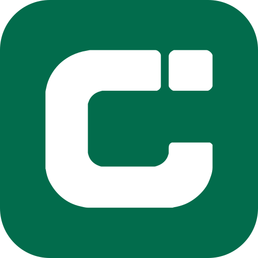

# Chisan for Claude

Ask Claude about the people and places behind local food and drink. Chisan
gives Claude a reviewed catalog of producers, their recorded products and food
fairs, so it can build shortlists, compare options, plan food-focused trips and
point you to each producer's own channels. Every producer profile passes
editorial review before Chisan publishes it.

Coverage currently includes Spain. Other countries will follow as their
catalogs are reviewed and published; producer and event coverage may differ.

## Try it

- “Busca queserías a menos de 30 km de Vic y compara cuáles tienen visitas o venta online.”
- “Plan a Saturday around food fairs within 80 km of Girona this month, with the producers listed at each.”
- “Here's a photo of a market stall: list the producers and products in order and link the ones Chisan knows.”
- “I source olive oil for a restaurant: which producers near Lleida record professional sales and delivery?”

Claude picks up the skills when a request is about local food, producers or
fairs. In Claude Code you can also call them directly, for example
`/chisan:local-food-discovery`.

## What's inside

- **`local-food-discovery`**: producers, products and fairs by place, radius,
  date and category, with nearest-first results and map links.
- **`photo-to-producers`**: turns photos of shelves, menus, stands or fair plans
  into an ordered inventory, matches what Chisan knows and prepares the rest as
  research leads in the conversation.
- **`truthfulness-and-handoff`**: keeps recorded facts apart from live claims
  such as stock, prices or opening hours, and hands you the producer's own phone,
  email, WhatsApp or shop link.
- **One MCP server**: Chisan's public, read-only catalog at
  `https://chisan.app/mcp`.

Results include producer and venue coordinates. Where the Claude surface can
draw a map, Claude can place them on one; every result also links to the
producer's Chisan map.

The plugin runs no local code, hooks or scripts.

## Data and network use

The only destination is `https://chisan.app/mcp`. It receives the text of each
catalog query Claude makes (for example a food, a town, a radius or a date
range) and returns published catalog records. The connection is anonymous: no
Chisan account, key or sign-in. Photos stay with Claude; Chisan receives text
searches only. Chisan never asks for your location; searches use a town you
name.

The tools read public information. They do not save research leads to Chisan,
send messages, book visits, place orders or take payments. Confirm stock,
prices, opening hours and visits with the producer or organiser.

Privacy: <https://chisan.app/privacy> · Terms: <https://chisan.app/legal> ·
Support: <https://chisan.app/contact>

## Versions

See the [changelog](CHANGELOG.md). The plugin files are released under the
[MIT License](LICENSE); the Chisan name, logo and catalog data are not covered
by that license.
